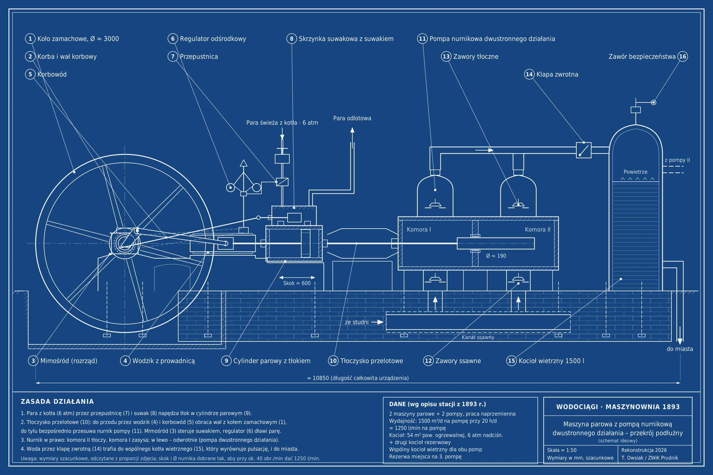

# Pompa parowa 1893

Rekonstrukcja zasady działania parowej maszyny pompowej ze stacji wodociągowej z 1893 roku: maszyna parowa w układzie tandem z pompą nurnikową dwustronnego działania i kotłem wietrznym.

**▶ [Zobacz animację](https://tomaszowsiak-cloud.github.io/pompa-parowa-1893/)**

Animacja pokazuje pracę całej maszyny: obrót koła zamachowego, ruch tłoka i nurnika, pracę suwaka i przepływ pary, otwieranie zaworów pompy oraz działanie kotła wietrznego. Można zmieniać obroty i wyłączyć kocioł wietrzny, żeby zobaczyć, jak bez niego pulsuje przepływ do sieci.

## Dane stacji (wg opisu z 1893 r.)

- W budynku maszynowym pracowały dwie pompy tłokowe (nurnikowe) dwustronnego działania (*doppeltwirkende Plungerpumpen*), napędzane dwiema maszynami parowymi.
- Parę dostarczał kocioł o powierzchni ogrzewalnej 54 m² i ciśnieniu roboczym 6 atm nadciśnienia; drugi, identyczny kocioł stał w rezerwie.
- Każda pompa była zwymiarowana na 1500 m³ wody na dobę przy 20 godzinach pracy, czyli 1250 l/min.
- Początkowo pompy pracowały naprzemiennie. Stację zaprojektowano tak, by przy rosnącym zapotrzebowaniu łatwo dołożyć trzecią pompę.
- Rury tłoczne obu pomp uchodziły do wspólnego kotła wietrznego (*Windkessel*) o pojemności 1500 l, wyposażonego w klapę zwrotną i zawór bezpieczeństwa.

## Zawartość

| Plik | Co zawiera |
|---|---|
| [`index.html`](index.html) | Interaktywna animacja pracy maszyny |
| [`opis-elementow.md`](opis-elementow.md) | Opis 16 elementów maszyny i ich funkcji |
| [`rysunki/pompa_parowa_1893_blueprint_PL.png`](rysunki/pompa_parowa_1893_blueprint_PL.png) | Rysunek w stylu blueprintu, opisy po polsku (też `.svg`) |
| [`rysunki/pompa_parowa_1893_blueprint_DE.png`](rysunki/pompa_parowa_1893_blueprint_DE.png) | Wersja z opisami po niemiecku, stylizowana na epokę (też `.svg`) |
| [`rysunki/pompa_1893_gemini_opisana.png`](rysunki/pompa_1893_gemini_opisana.png) | Ilustracja wygenerowana przez Gemini, z naniesionymi polskimi opisami |

## Zastrzeżenia

To schemat ideowy, nie dokumentacja techniczna. Układ maszyny odtworzono na podstawie archiwalnego zdjęcia i opisu stacji. Wymiary (średnica koła zamachowego ok. 3 m, skok ok. 600 mm, średnica nurnika ok. 190 mm) są szacunkowe, odczytane z proporcji na zdjęciu i dobrane tak, by przy ok. 40 obr/min dać 1250 l/min. Rozrząd w animacji jest uproszczony: pokazuje zasadę działania suwaka, ale nie rzeczywiste kąty napełnienia.

## Autorzy

Tomasz Owsiak, ZWiK Prudnik – w ramach cyklu „Z Kącika Technologa z przypadku”.
Opracowanie rysunków, opisów i animacji we współpracy z Claude (Anthropic).
